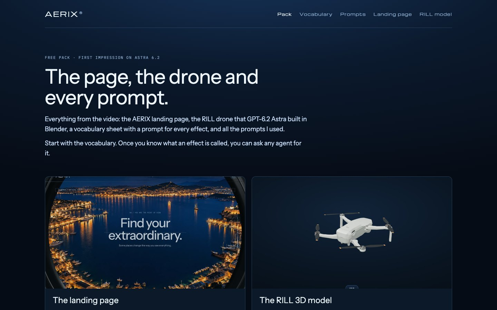

# AERIX, the free pack

The landing page, the 3D drone and every prompt from my video **First Impression on Astra 6.2**, sponsored by Higgsfield.

**Open it online:** https://sam1983aing.github.io/aerix-pack/



Or download the repo and open `index.html`. Everything also opens from your disk, no install needed.

## What's inside

| | Where | What it is |
|---|---|---|
| The landing page | `AERIX.html` | The AERIX page as one file. Double-click it. Online: [the live page](https://sam1983aing.github.io/aerix-pack/page/). |
| Its source | `page/` | The same page as plain HTML, CSS and JavaScript, no build step. |
| The RILL model | `model/RILL-viewer.html`, `model/rill.glb` | The drone GPT-6.2 Astra built in Blender, with its fold animation. |
| The Blender scripts | `model/blender-scripts/` | The Python scripts that built RILL, one per version, V01 to V14c. |
| Vocabulary | `sheets/vocabulary.html` | 21 techniques from the page with a copy-paste prompt for each. |
| Prompts | `sheets/prompts.html` | The starter prompt, the Higgsfield world prompts with settings and cost, and every message that built RILL. |

## Run the source

`AERIX.html` works by double-click. The `page/` folder uses JavaScript modules, so serve it:

```bash
cd page
python3 -m http.server 8000
```

Then open http://localhost:8000. The page is plain HTML, CSS and JavaScript with three.js, GSAP and Lenis, and no build step.

## The worlds behind the drone

In the video, each world is a 5 second clip made with Seedance 2.5 on Higgsfield and upscaled to 4K. Those clips stay with the video, so the page here uses the September stills and doesn't wait on any clip. The prompts that made them are in `sheets/prompts.html`.

To bring video back, put a 16:9 MP4 in `page/assets/worlds/clips/` and set `clip:'worlds/clips/your-clip.mp4'` on that world in `page/js/flight-worlds.js`. The page then plays it when the world fades in, and the scroll waits for it to finish.

## How the page is put together

- `page/main.js` holds the scroll and the story clock: one number from 0 to 8 drives everything.
- `page/js/scene.js` is the 3D scene: the model, the studies, the camera and the render loop.
- `page/js/effects.js` draws the sky and the worlds and plays the clips. `page/js/flight-worlds.js` lists the worlds.
- `page/js/polish/` holds the motion layer: card reveals, text decode, the particle title (`motion.js`), part labels (`ui-refresh.js`), the menu hover (`nav-hover.js`).
- `page/js/part-pins.js` draws the numbered pins. `page/js/finishes.js` lists the five finishes.
- `page/assets/model/` is the AERIX drone, split so a light version shows first and the rest streams in (`manifest.json`).

## About RILL and the scripts

RILL was built from the measurements of a real foldable camera drone, then given its own design and name. The scripts show how GPT-6.2 Astra built it, version by version, from a grey blockout to the finished outside. They expect the project's folder layout and reference files, which aren't included, so read them to learn the method rather than to run them as they are. Blender 5.2.

## Credits and licences

- The code of the page and the viewer: MIT (`LICENSE`).
- [three.js](https://threejs.org) (MIT), [GSAP](https://gsap.com) (GSAP's standard licence, free), [Lenis](https://lenis.darkroom.engineering) (MIT, `page/vendor/LENIS-LICENSE`), [Draco](https://google.github.io/draco/) (Apache 2.0, `page/vendor/draco/LICENSE`).
- Fonts: Michroma, Instrument Sans and IBM Plex Mono, under the SIL Open Font License (`page/assets/fonts/`).
- The AERIX and RILL models are mine, built with GPT-6 Astra and GPT-6.2 Astra. Use them to learn and to build your own pages.

## Find me

[X](https://x.com/SammmAing) · [LinkedIn](https://www.linkedin.com/in/samnang-aing-639168341/) · [Threads](https://www.threads.com/@prompting_lab/) · [Instagram](https://www.instagram.com/samnang.aing/)
